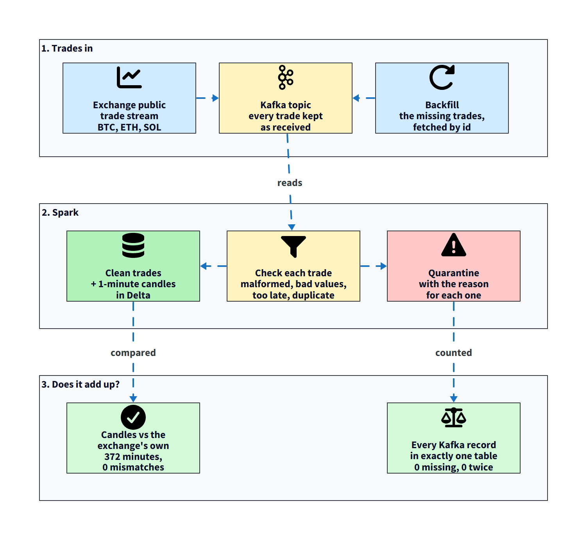

# tick-ledger



A small streaming pipeline that proves its own numbers. It reads live trades from Binance's public WebSocket, passes them through Kafka, builds one-minute candles with Spark Structured Streaming into Delta tables, and then checks the result two ways: against Kafka (is every record accounted for?) and against Binance's own candles (do they match?).

**Setup:** Apache Kafka 3.9.0 (KRaft, one broker), Spark 3.5.3 (local mode), Delta Lake 3.2.1, DuckDB for the checks, Docker Compose. Three pairs: BTCUSDT, ETHUSDT, SOLUSDT. Public market data only, no keys. Every number below is from that run and is in [RESULTS.md](RESULTS.md). Traps I hit are in [DECISIONS.md](DECISIONS.md).

**About the numbers:** they come from one real run on 2 November 2026 (a few hours, with gaps). After that run I deleted the raw Kafka topic by mistake (a storage mix-up, written up in [DECISIONS.md](DECISIONS.md)), so the run cannot be replayed from this repo and the data is not included. The compose file is fixed, and the checks (`src/reconcile.py`) can be re-run on any new run.

## What the run showed

- Every Kafka record ended in exactly one place, `trades_clean` or `trades_rejected`: 370,482 records at the last check, none missing, none counted twice, including after killing Spark mid-stream.
- 372 complete minutes matched Binance's own one-minute candles on open, high, low, close, volume and trade count, with zero mismatches, after filling the gaps.
- Four deliberately bad messages (a copy of a real trade, text that is not JSON, a negative price, a trade an hour old) were each rejected with the right reason.
- The checks found 153,714 trades the pipeline never received (a host pause, a producer outage, a few short drops). `src/backfill.py` fetched exactly those ids from the exchange and put them through the same checks; afterwards no gap was left.

## Why it exists

This one asks whether the stream adds up: every Kafka record has to end up in exactly one table, and every candle has to match the exchange's own. It found 153,714 trades it never received, filled them from the exchange, and then matched 372 minutes with zero mismatches. The mistakes along the way are in [DECISIONS.md](DECISIONS.md).

## Run it

```
docker compose up -d --build
uv venv --python 3.14 .venv
uv pip install --python .venv/Scripts/python.exe duckdb pytz
.venv/Scripts/python src/reconcile.py        # prints the report, exit code 1 on any failure
.venv/Scripts/python src/drills/inject.py    # drill 1: send bad messages
```

## Not done

More than one Kafka partition, more than one Spark node, long runs (the longest so far is a few hours with gaps), and any claim about throughput beyond "kept roughly in step with about 75 messages a second on a laptop".
